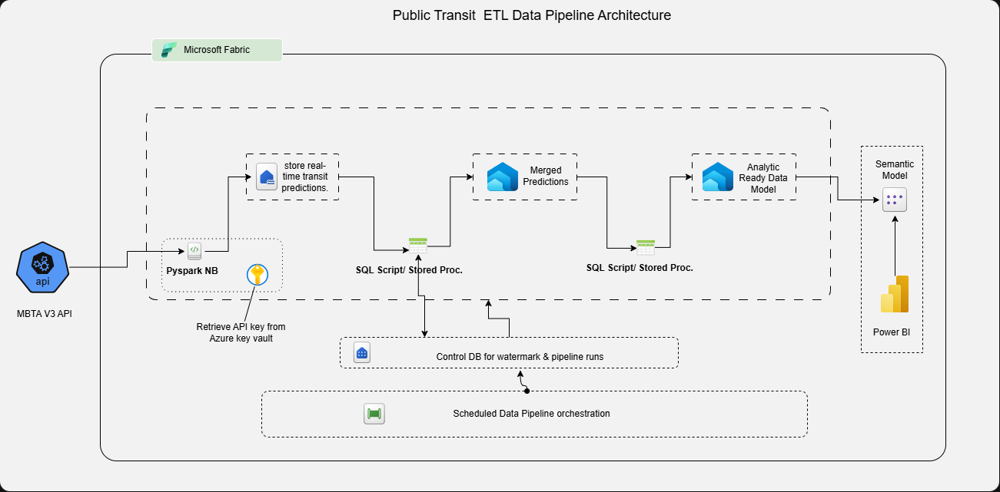
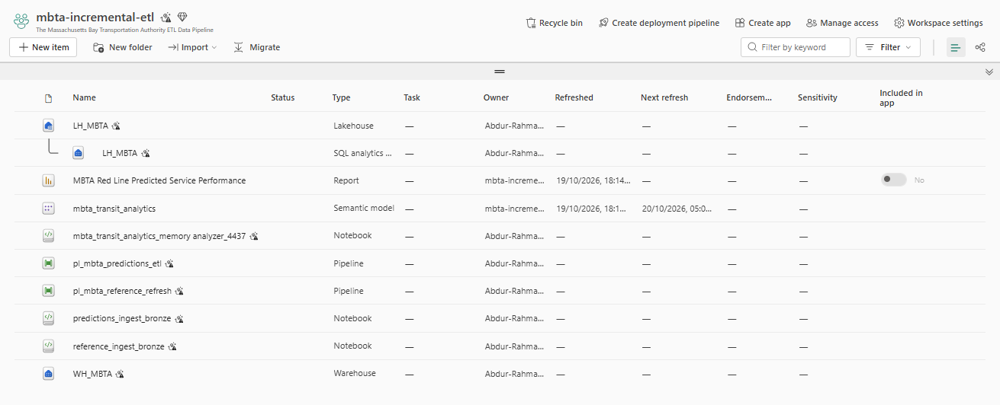
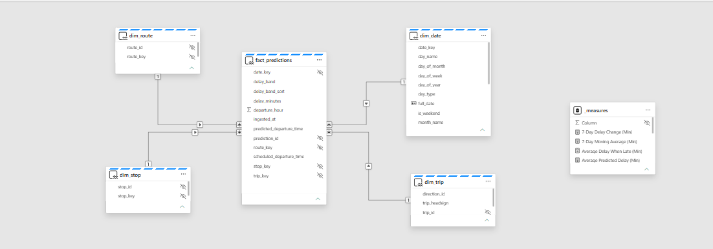
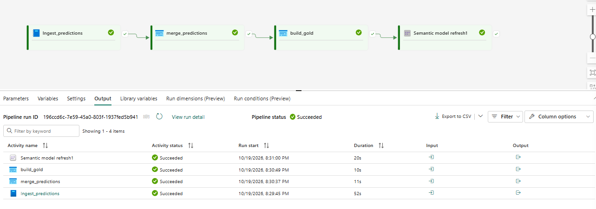
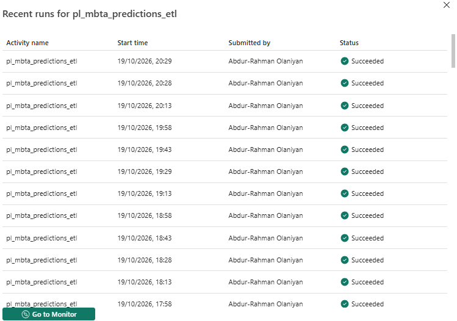
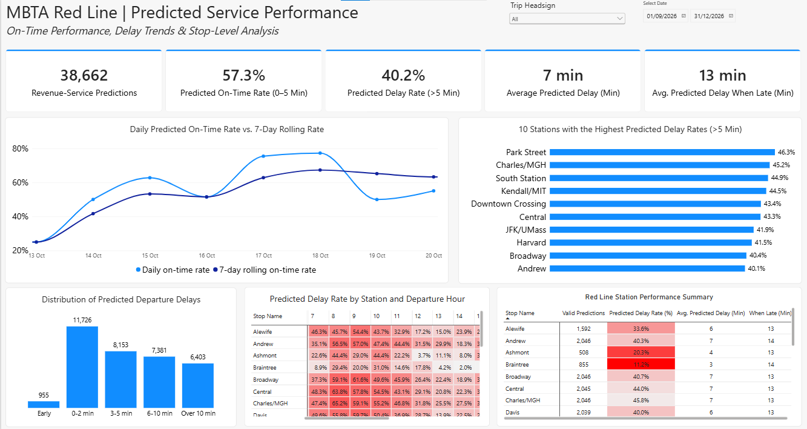

# MBTA Red Line Prediction Analytics with Microsoft Fabric

This project builds an incremental data pipeline for Massachusetts Bay Transportation Authority (MBTA) Red Line predictions using Microsoft Fabric. It retrieves prediction and reference data from the MBTA V3 API, stores source records in a Lakehouse, transforms them in a Fabric Data Warehouse, and uses Power BI to report predicted service performance. The pipeline is designed to run repeatedly as new prediction data becomes available.

**Data source:** [MBTA V3 API](https://api-v3.mbta.com/)

## Project Objective

The project provides a way to examine predicted delays, on-time performance, and differences between stations and departure hours.

## Pipeline Architecture



The Bronze notebooks use Python and PySpark to ingest Red Line predictions, routes, stops, and trips into Delta tables in the Fabric Lakehouse. Prediction records are appended with an ingestion timestamp, while the reference tables are refreshed using overwrite mode.

The Silver stored procedure reads newly ingested predictions using a watermark, selects the latest record per prediction ID, joins route, stop, and trip details, and calculates predicted departure delay. The Gold procedure builds route, stop, and trip dimensions and a predictions fact table, including departure hour and delay categories. The Gold tables are used for reporting in Power BI.

## Microsoft Fabric Workspace



The implementation uses a Fabric Lakehouse (`LH_MBTA`), Data Warehouse (`WH_MBTA`), notebooks, data pipelines, a semantic model, and a Power BI report. Azure Key Vault stores the MBTA API key used by the ingestion notebooks. The Warehouse also stores the processing watermark and execution logs.

## Reproduce the Project

1. **Clone the repository.**

   ```bash
   git clone https://github.com/AbdurRahman-Olaniyan/End-to-End-Public-Transit-Data-Analytics-with-Microsoft-Fabric.git
   cd End-to-End-Public-Transit-Data-Analytics-with-Microsoft-Fabric
   ```

2. **Create the Fabric items.** In a Microsoft Fabric workspace, create a Lakehouse named `LH_MBTA` and a Warehouse named `WH_MBTA`. Generate your own API key from [MBTA V3 API](https://api-v3.mbta.com/). Create an Azure Key Vault secret In Microsoft Azure, named `mbta-api-key` containing your MBTA API key.

3. **Set up the Warehouse.** Run the SQL files in this order against `WH_MBTA`: [`schema_setup.sql`](sql/schema_setup.sql), [`ddl_control.sql`](sql/ddl_control.sql), [`ddl_silver.sql`](sql/ddl_silver.sql), [`ddl_gold.sql`](sql/ddl_gold.sql), and [`load_dimdate.sql`](sql/load_dimdate.sql). The control script initializes the `predictions_red_line` watermark. The date script populates September through December 2026; adjust its dates if your reporting period differs.

4. **Load Bronze data.** Import and attach [`reference_ingest_bronze.ipynb`](notebooks/reference_ingest_bronze.ipynb) and [`predictions_ingest_bronze.ipynb`](notebooks/predictions_ingest_bronze.ipynb) to `LH_MBTA`. Run the reference notebook first to create the route, stop, and trip tables, then run the predictions notebook to append prediction records. Update the vault URL in both notebooks with your own and ensure the notebooks can access the secret and write to the Lakehouse and Warehouse.

5. **Create and run the transformations.** Run [`usp_merge_silver.sql`](sql/usp_merge_silver.sql) and [`usp_build_gold.sql`](sql/usp_build_gold.sql) in the Warehouse to create the stored procedures. Execute `silver.usp_merge_predictions` followed by `gold.usp_build_gold` to populate the reporting tables.

6. **Set up repeat runs.** Create a Fabric Data Pipeline that runs prediction ingestion, the Silver merge, and the Gold build in that order. Configure the pipeline schedule to suit your ingestion frequency.

    Recreating the Pipeline

    - Create a Data Pipeline in the Fabric workspace and name it `pl_mbta_predictions_etl`.
    - Add a Notebook activity named `ingest_predictions` and select the `predictions_ingest_bronze` notebook.
    - Add a stored procedure activity named `merge_predictions` and configure it to run `silver.usp_merge_predictions` in the Fabric Warehouse.
    - Add another stored procedure activity named `build_gold` and configure it to run `gold.usp_build_gold`.
    - Add the semantic model refresh activity for the report model. Connect the activities in the order shown in the pipeline screenshot, then run the pipeline and inspect its activity results.

7. **Build the report.** Create a Power BI semantic model from the Gold tables and build the predicted service performance report.
      The Power BI semantic model uses a star schema, with `fact_predictions` connected to `dim_route`, `dim_stop`, `dim_trip`, and `dim_date` through their corresponding keys. Each dimension has a one-to-many relationship with the fact table, allowing the report to filter prediction records by route, stop, trip, and date.

      Create the relationships shown below. Set the relationship cardinality to one-to-many, with single-direction filtering from each dimension to the fact table. Create the DAX measures needed for the report in a separate `_measures` table.



## Pipeline Execution



The pipeline runs the ingestion and transformation stages in sequence. The SQL procedures record successful and failed executions in `control.pipeline_runs`, while the Silver procedure updates `control.watermark` after processing. The pipeline can be scheduled to run at a preferred interval, such as every 15 minutes, to ingest new MBTA prediction data at regular intervals and support near-real-time reporting.



## Power BI Report



The report presents revenue-service prediction counts, predicted on-time rates, average predicted delay, delay distribution, and station-level comparisons. 

## Implementation Documentation

The notebooks and stored procedures have separate technical notes for readers who want to examine the code:

- [Prediction ingestion notebook](docs/prediction_ingest_NB_README.md)
- [Reference ingestion notebook](docs/reference_ingest_NB_README.md)
- [Silver merge procedure](docs/usp_merge_silver_README.md)
- [Gold build procedure](docs/usp_build_gold_README.md)

The notebooks and SQL scripts are available under [`notebooks/`](notebooks/) and [`sql/`](sql/).
